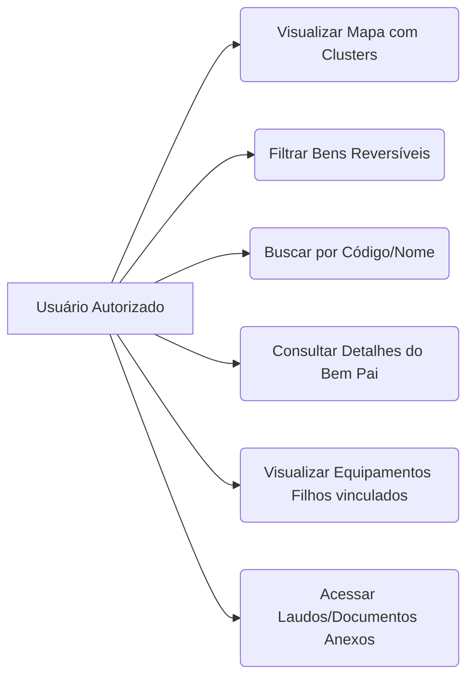
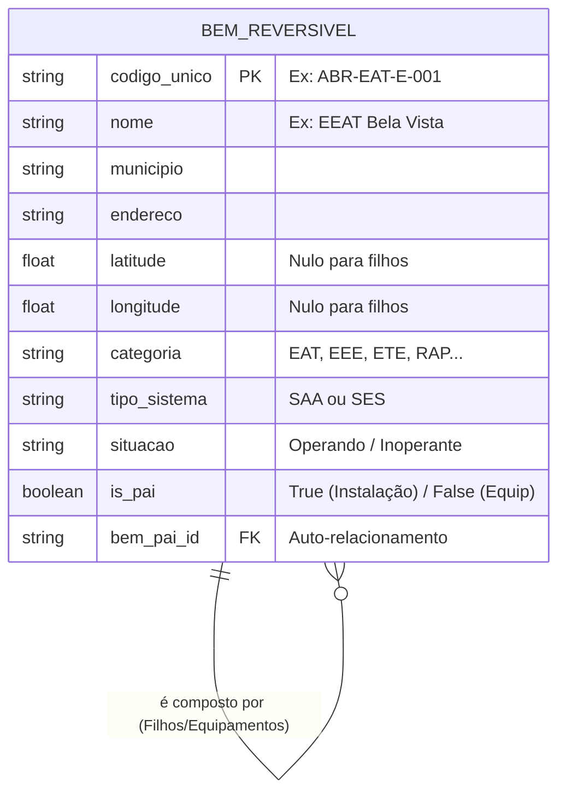

# Documentação de Domínio e Escopo — buscARPE

## 1. Visão Geral e Objetivo
O **buscARPE** é uma aplicação interna destinada à consulta e visualização de informações sobre bens reversíveis relacionados aos sistemas de saneamento de Pernambuco. 
Seu objetivo principal é centralizar as informações fragmentadas, permitindo consulta rápida, filtragem e visualização geográfica (Mapa) com base nos dados do "Documento Final Oficial" da concessionária.

## 2. Escopo do MVP (Produto Mínimo Viável)
**O que ESTÁ no MVP:**
* Visualização de Bens Pais (Instalações) em Mapa interativo com clusterização.
* Filtragem avançada (Geografia, Sistemas, Situação).
* Visualização de detalhes do Bem Pai, lista de Equipamentos (Bens Filhos) e Documentos anexos.
* Carga de dados via script de backend lendo diretamente da planilha oficial (Seed).

**O que NÃO ESTÁ no MVP:**
* Telas de administração para inserção, edição ou exclusão manual de bens.
* Fluxos de aprovação ou gestão complexa de documentos.
* Sincronização em tempo real com o aplicativo *Inventory*.

## 3. Glossário de Domínio
* **SAA (Sistema de Abastecimento de Água):** Engloba estações de tratamento (EAT/EEAT) e reservatórios (RES, RAP, REL).
* **SES (Sistema de Esgotamento Sanitário):** Engloba estações elevatórias e de tratamento de esgoto (EEE, ETE).
* **Bem Pai (Instalação):** A unidade física geográfica (ex: Estação, Reservatório). É o elemento plotado no mapa utilizando Latitude e Longitude.
* **Bem Filho (Equipamento):** Componentes alocados dentro de um Bem Pai (ex: Bombas, Painéis). Não possuem coordenada própria no mapa.
* **Situação do Bem:** Estado operacional do bem, restrito atualmente a "Operando" ou "Inoperante" (desativado/abandonado/obsoleto).

## 4. Regras Geográficas e Enriquecimento de Dados
A fonte oficial de dados (planilha) contém a coluna `MUNICÍPIO`. Para garantir a integridade e evitar erros humanos de preenchimento na origem, o buscARPE manterá uma **Tabela de Domínio Interna** que mapeará automaticamente os 184 municípios de Pernambuco para:
* **As 12 GERES** (Gerências Regionais de Saúde / Polos).
* **As 2 Microrregiões** (MRAE-I Sertão e MRAE-II RMR–Pajeú).

## 5. Diagramas do Sistema

### 5.1. Casos de Uso (Atores e Ações)

### 5.2. Modelo Conceitual de Dados (Entidade-Relacionamento)

## 6. Layout e Interação (UI/UX)
* **Painel Esquerdo (Gaveta):** Filtros avançados em formato "sanfona" (Microrregião, GERES, Município, Sistema, Categoria, Situação).
* **Centro:** Mapa ocupando a área principal. Utiliza *clustering* (agrupamento numérico) que se desmembra em pinos individuais conforme o nível de *zoom*.
* **Painel Direito/Central (Modal/Gaveta Flutuante):** Ao clicar em um Bem Pai, exibe abas:
  1. `Visão Geral` (Dados cadastrais da Instalação)
  2. `Equipamentos` (Lista de Bens Filhos)
  3. `Documentos` (Links para PDFs)
