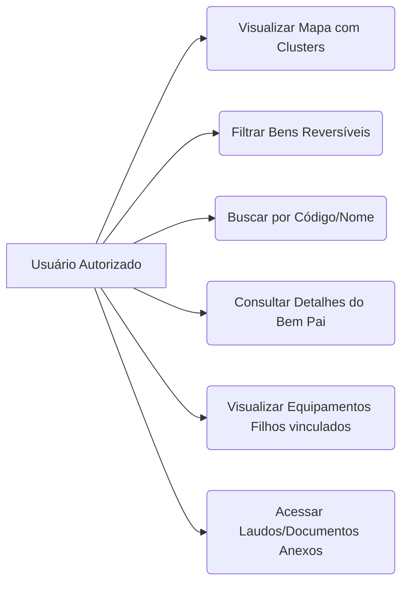
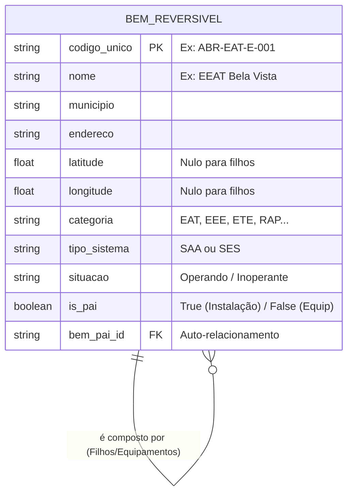

# Documentação de Domínio e Escopo — buscARPE

## 1. Visão Geral e Objetivo

O **buscARPE** é uma aplicação interna destinada à consulta e visualização de informações sobre bens reversíveis relacionados aos sistemas de saneamento de Pernambuco.
Seu objetivo principal é centralizar as informações fragmentadas, permitindo consulta rápida, filtragem e visualização geográfica (Mapa) com base nos dados do "Documento Final Oficial" da concessionária.

## 2. Escopo do MVP (Produto Mínimo Viável)

**O que ESTÁ no MVP:**

- Visualização de Bens Pais (Instalações) em Mapa interativo com clusterização.
- Filtragem avançada (Geografia, Sistemas, Situação).
- Visualização de detalhes do Bem Pai, lista de Equipamentos (Bens Filhos) e Documentos anexos.
- Carga de dados via script de backend lendo diretamente da planilha oficial (Seed).

**O que NÃO ESTÁ no MVP:**

- Telas de administração para inserção, edição ou exclusão manual de bens.
- Fluxos de aprovação ou gestão complexa de documentos.
- Sincronização em tempo real com o aplicativo _Inventory_.

## 3. Glossário de Domínio

- **SAA (Sistema de Abastecimento de Água):** Engloba estações de tratamento (EAT/EEAT) e reservatórios (RES, RAP, REL).
- **SES (Sistema de Esgotamento Sanitário):** Engloba estações elevatórias e de tratamento de esgoto (EEE, ETE).
- **Bem Pai (Instalação):** A unidade física geográfica (ex: Estação, Reservatório). É o elemento plotado no mapa utilizando Latitude e Longitude.
- **Bem Filho (Equipamento):** Componentes alocados dentro de um Bem Pai (ex: Bombas, Painéis). Não possuem coordenada própria no mapa.
- **Situação do Bem:** Estado operacional ou não informado do bem: "Operando", "Inoperante" ou "N/I".

## 4. Regra de Busca por Texto

- A busca textual utilizada para localizar marcadores no mapa considera somente atributos do **Bem Pai**: código da instalação, nome da instalação, endereço, município, categoria, sistema e situação.
- Cada Bem Filho mantém seu próprio índice textual, composto pelos dados do equipamento. Esse índice não é incorporado ao índice do pai e não participa da busca de instalações no mapa.
- Os textos de busca são normalizados para minúsculas e sem acentos. A normalização do termo pesquisado deve seguir a mesma regra.

## 5. Regras Geográficas e Enriquecimento de Dados

A fonte oficial de dados (planilha) contém a coluna `MUNICÍPIO`. Para garantir a integridade e evitar erros humanos de preenchimento na origem, o buscARPE manterá uma **Tabela de Domínio Interna** que mapeará automaticamente os 184 municípios de Pernambuco para:

- **As 12 GERES** (Gerências Regionais de Saúde / Polos).
- **As 2 Microrregiões** (MRAE-I Sertão e MRAE-II RMR–Pajeú).

## 6. Distribuição de Dados Complementares

- Os dados excedentes referentes à instalação, que não possuem coluna núcleo no modelo, serão armazenados em `dados_complementares` do Bem Pai.
- Os dados excedentes referentes a cada equipamento serão armazenados em `dados_complementares` do respectivo Bem Filho.
- Os dados de equipamentos permanecem associados aos filhos e não são agregados aos dados complementares nem ao índice de busca do pai.
- `MUNICIPIO` e `ENDERECO` da instalação preenchem os campos núcleo do Bem Pai. `CONDICAO_OPERACIONAL` permanece nos dados complementares do filho; a situação do pai é derivada das situações dos equipamentos.
- As condições `Ativo Ausente (inexistente)`, `Ativo Ausente (manutencao)`, `Nao Instalado` e `Nunca operou` são normalizadas como situação `Inoperante` para o Bem Filho e para o cálculo da situação do pai. O texto original permanece em `dados_complementares.CONDICAO_OPERACIONAL`.
- As condições originais `N/I` e `Outro` são normalizadas como situação `N/I` no Bem Filho, preservando o rótulo original em `dados_complementares.CONDICAO_OPERACIONAL`.
- A situação do Bem Pai é `Operando` se ao menos um filho estiver Operando; é `N/I` se todos os filhos forem N/I; nos demais casos sem filho Operando, é `Inoperante`.
- O conjunto de dados complementares do pai é configurável em `seed-config.ts` e, com a planilha de referência atual, contém `ID_ATIVO_PAI`, `NOME_ATIVO_PAI`, `MICRORREGIAO`, `SISTEMA` e `SISTEMA_UNIDADE`. Os demais campos originais de cada equipamento ficam no JSONB do respectivo filho, exceto os campos núcleo.
- O montador prepara os payloads de pais e filhos em memória e valida se os atributos repetidos da instalação são consistentes antes de qualquer gravação no banco.

## 7. Ingestão de Planilhas

- O seed de bens lê arquivos CSV e XLSX por meio do SheetJS Community Edition (CE) 0.20.3. A biblioteca converte as planilhas em linhas e células; o leitor do buscARPE valida os cabeçalhos configurados e converte os campos para o formato interno usado pelo agrupamento e pela montagem dos payloads.
- A dependência é instalada pelo tarball oficial da SheetJS, fixado no `package.json` e no lockfile. O pacote homônimo `xlsx` disponível no npm registry está desatualizado e não deve ser usado como substituto.
- CSV e XLSX são carregados em memória pelo leitor atual. A planilha é uma entrada local do processo de seed; essa decisão não torna seguro aceitar arquivos enviados por usuários ou processar planilhas não confiáveis em endpoints públicos.
- A justificativa, alternativas, trade-offs, riscos e critérios de revisão da biblioteca estão registrados na [ADR-0001](../03-arquitetura/adr/ADR-0001-leitura-de-planilhas-com-sheetjs.md).
- O comando `npm run seed:bens -- <arquivo>` integra a leitura, o agrupamento, a associação com municípios e a persistência via Prisma. A persistência usa upsert por `codigo_unico`, processa até 50 instalações por transação por padrão e grava o Bem Pai antes de seus Filhos.
- Instalações sem município de domínio correspondente ou com filhos associados a municípios diferentes são adiadas integralmente, não gravadas no banco e listadas em relatório CSV com código, linha, município informado e motivo. O relatório é salvo junto à planilha de entrada com nome único por execução para permitir análise posterior.
- Os lotes concluídos antes de uma falha de persistência permanecem gravados; a falha interrompe os próximos lotes e é informada. Uma reexecução atualiza os registros de mesmos códigos, mas bens ausentes da planilha não são excluídos automaticamente. O comando emite resumo de conferência e contagens de avisos sem imprimir valores brutos da planilha.
- A execução do comando conecta e grava no banco definido por `DATABASE_URL`. A implementação do comando, por si só, não o executa; a carga e a aplicação de migrations precisam ser feitas conscientemente no banco-alvo.

## 8. Diagramas do Sistema

### 8.1. Casos de Uso (Atores e Ações)

### 8.2. Modelo Conceitual de Dados (Entidade-Relacionamento)

## 8. Layout e Interação (UI/UX)

- **Painel Esquerdo (Gaveta):** Filtros avançados em formato "sanfona" (Microrregião, GERES, Município, Sistema, Categoria, Situação).
- **Centro:** Mapa ocupando a área principal. Utiliza _clustering_ (agrupamento numérico) que se desmembra em pinos individuais conforme o nível de _zoom_.
- **Painel Direito/Central (Modal/Gaveta Flutuante):** Ao clicar em um Bem Pai, exibe abas:
  1. `Visão Geral` (Dados cadastrais da Instalação)
  2. `Equipamentos` (Lista de Bens Filhos)
  3. `Documentos` (Links para PDFs)

## Histórico de Alterações

| Data       | Alteração                                                                                                                                                                                                   |
| ---------- | ----------------------------------------------------------------------------------------------------------------------------------------------------------------------------------------------------------- |
| 2026-10-22 | Definido que a busca do mapa considera somente atributos dos Bens Pais; cada Bem Filho mantém índice próprio, sem contribuir para a busca da instalação.                                                    |
| 2026-10-22 | Definido que dados complementares da instalação ficam no Bem Pai e dados complementares de equipamentos ficam nos respectivos Bens Filhos.                                                                  |
| 2026-10-22 | Documentada a distribuição dos campos núcleo e JSONB e a validação de consistência na preparação em memória dos payloads do seed.                                                                           |
| 2026-10-23 | Documentada a leitura CSV/XLSX com SheetJS CE e a restrição de uso a arquivos locais e controlados no processo de seed; ver [ADR-0001](../03-arquitetura/adr/ADR-0001-leitura-de-planilhas-com-sheetjs.md). |
| 2026-10-23 | Documentado o comando de carga de bens, o upsert em transações por lote, a preservação de registros ausentes da planilha e o efeito de escrita no banco.                                                    |
| 2026-10-23 | Definido que `Ativo Ausente (inexistente)`, `Ativo Ausente (manutencao)`, `Nao Instalado` e `Nunca operou` são normalizados como `Inoperante`; inicialmente, `N/I` e `Outro` bloqueavam a preparação.       |
| 2026-10-23 | Ampliada a situação do Bem para incluir `N/I`; condições originais `N/I` e `Outro` geram situação N/I nos filhos, e o pai recebe N/I somente quando todos os filhos forem N/I.                              |
| 2026-10-23 | Definido que instalações com município não associado ao domínio ou divergente entre filhos são adiadas e registradas em relatório local para análise futura, sem gravação no banco. |
| 2026-10-28 | Alinhamento com a entrega final do MVP: inclusão formal do suporte à situação "Não Informado" (NAO_INFORMADO) no filtro de busca e nos detalhes cadastrais, além do fechamento do pipeline de autenticação segura com JWT e cookies httpOnly. |
