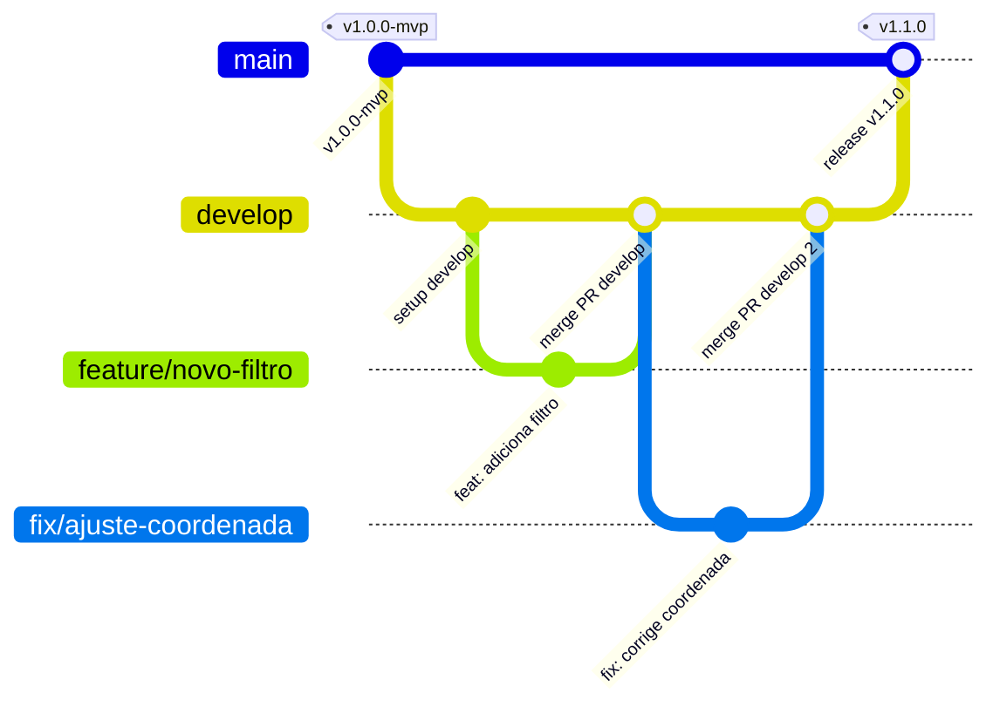

# Padrão de Versionamento e Fluxo de Branches — buscARPE

Este documento estabelece as diretrizes oficiais de controle de versão (Git), estratégia de ramificação (*branching model*) e convenção de commits para o projeto **buscARPE**.

---

## 🏛️ Estrutura de Branches (Git Flow Moderno)

O buscARPE adota o **Git Flow Moderno**, equilibrando a segurança de integração contínua com a agilidade do desenvolvimento em equipe:



### 1. Branches Permanentes

* **`main` (Produção):**
  - Representa o código em produção, sempre estável, homologado e pronto para deploy.
  - **Regra de ouro:** Ninguém faz commits diretos na `main`. Todas as alterações chegam via Pull Request (PR) vindo da `develop` ou através de `hotfix/*`.
  - Cada merge na `main` gera uma nova tag semântica (ex: `v1.0.0`, `v1.1.0`).

* **`develop` (Integração e Homologação):**
  - Branch central de desenvolvimento e integração contínua.
  - Recebe as novas funcionalidades e correções aprovadas da equipe.
  - É a branch base a partir da qual as novas tarefas são iniciadas e para onde os Pull Requests são abertos.

---

### 2. Branches Temporárias de Trabalho

Toda nova tarefa deve ser desenvolvida em uma branch isolada, criada a partir da `develop` e seguindo o padrão semântico:

| Prefixo | Finalidade | Exemplo de Nome de Branch |
| :--- | :--- | :--- |
| `feature/` | Novas funcionalidades, filtros ou painéis | `feature/exportacao-relatorio-csv`<br>`feature/card-4.1-novo-filtro` |
| `fix/` | Correção de defeitos encontrados em homologação | `fix/ajuste-opacidade-inoperante`<br>`fix/cascata-municipios-geres` |
| `refactor/` | Melhorias estruturais de código ou performance sem alterar comportamento | `refactor/otimizacao-queries-prisma`<br>`refactor/componentes-mapa` |
| `test/` | Criação ou expansão de testes unitários ou de integração | `test/cobertura-jwt-guard`<br>`test/e2e-fluxo-filtros` |
| `docs/` | Atualização exclusiva de documentação, diagramas ou README | `docs/guia-deploy-nuvem`<br>`docs/regras-de-negocio` |
| `hotfix/` | Correções críticas e urgentes em produção (criada diretamente da `main`) | `hotfix/vazamento-memoria-mapa` |

---

## 🔄 Fluxo de Trabalho do Desenvolvedor (Passo a Passo)

### 1. Atualizar a base local
Sempre inicie seu trabalho sincronizando sua máquina com o repositório remoto:
```bash
git checkout develop
git pull origin develop
```

### 2. Criar a branch da tarefa
Crie uma nova branch com nome descritivo:
```bash
git checkout -b feature/nome-da-sua-tarefa
```

### 3. Desenvolver e validar testes localmente
Durante e ao final do desenvolvimento, valide se todos os testes unitários continuam passando com 100% de sucesso e se a compilação está limpa:
```bash
# Validar testes do backend
cd backend && npm.cmd test

# Validar builds de produção
cd ../backend && npm.cmd run build
cd ../frontend && npm.cmd run build
```

### 4. Commitar seguindo o Conventional Commits
Utilize mensagens em português, no imperativo/presente e com escopo claro:
* `feat(escopo): descrição concisa` (novas funcionalidades)
* `fix(escopo): descrição da correção` (correções de bugs)
* `docs(escopo): descrição` (documentações)
* `test(escopo): descrição` (testes)
* `refactor(escopo): descrição` (refatorações)

Exemplo:
```bash
git commit -m "feat(filtros): adiciona busca de instalacoes por subcategoria"
```

### 5. Enviar para o GitHub e abrir Pull Request (PR)
Envie sua branch para o repositório remoto:
```bash
git push -u origin feature/nome-da-sua-tarefa
```
No GitHub:
- Abra um **Pull Request** apontando da sua branch para a `develop`.
- Solicite a revisão do tech lead ou de outro desenvolvedor.
- Após aprovado e com testes verdes no CI, o PR é mergeado na `develop` e a branch de trabalho pode ser deletada.

---

## 🏷️ Versionamento Semântico (SemVer)

O buscARPE segue o padrão **[SemVer (Semantic Versioning)](https://semver.org/lang/pt-BR/)**:

$$\text{MAJOR}.\text{MINOR}.\text{PATCH}$$

* **MAJOR (`1`.0.0):** Mudanças de grande porte ou que quebram compatibilidade retroativa de APIs.
* **MINOR (1.`1`.0):** Adição de novas funcionalidades retrocompatíveis (novas telas, novos filtros, relatórios).
* **PATCH (1.1.`1`):** Correções de bugs que não adicionam funcionalidades novas.

### Tags de Lançamento
Ao finalizar uma sprint ou ciclo e promover da `develop` para a `main`, cria-se uma tag anotada:
```bash
git tag -a v1.0.0-mvp -m "Versão 1.0.0 — Entrega oficial e congelamento do MVP buscARPE"
git push origin v1.0.0-mvp
```

